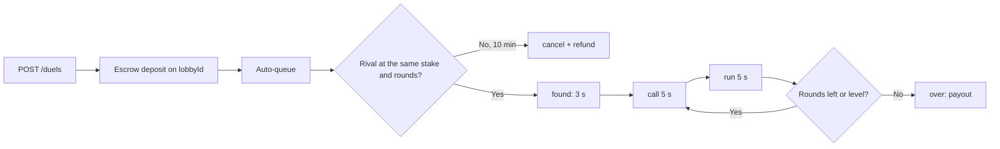

## What a duel is

A duel is "Up or down?" between two people on a live market (BTC, ETH and SOL by default). Both stake the same USDC. Each round:

1. **Call (5 s).** Each player calls `up` or `down`. Calls are sealed: the rival only sees that you called, never what.
2. **Lock.** At the end of the call window the API reads the **lock price** from the price feeds (the "entry").
3. **Run (5 s).** The price runs. At the end the API reads the **close price**.
4. **Settle.** `close > entry` went up, `close < entry` went down. A right call is a point.

After the planned rounds the higher score wins the pot. Level scores go to **sudden death**: rounds keep coming until exactly one player scores. The whole clock is absolute and server-side; it never pauses.

Settlement reads the same deterministic price series as every chart and game on DIM: the last tick at or before the instant, else the close of the last 1-second candle, never a tick after the instant and never an extrapolation (see [Prices](/guides/prices#realtime-ticks)). The provider's exact decimal string (`priceRaw`) is the audit value; flat means the two strings compare equal.

## Rules

The rules are served by `GET /duels/rules` and the SDK memoises them for a minute. **Never hardcode them**; the defaults today are:

| Rule              | Default                                           | Field                 |
| ----------------- | ------------------------------------------------- | --------------------- |
| Stakes            | $1, $5, $10, $25, $50, $100 (USDC minor units)    | `stakes`              |
| Rounds            | 5, 10 or 20                                       | `rounds`              |
| Start buffer      | 3 s between the match and the first round         | `startSeconds`        |
| Call window       | 5 s                                               | `callSeconds`         |
| Whole round       | 10 s (call + run)                                 | `roundSeconds`        |
| Flat close        | the round is replayed (same number, `attempt` +1) | `flatClose: 'replay'` |
| No call           | a miss: no point, the rival can still score       | `noCall: 'miss'`      |
| Tie               | sudden death                                      | `tie: 'sudden-death'` |
| Reconnect window  | 45 s to come back after a drop, then forfeit      | `reconnectSeconds`    |
| Queue timeout     | 10 min waiting for a rival, then cancel + refund  | `queueTimeoutSeconds` |
| Consecutive voids | 3 void rounds in a row cancel the duel (refunds)  | `maxConsecutiveVoids` |
| Fee               | 500 bps = 5 % of the winnings                     | `feeBps`              |

A round is **void** (replayed, never scored) when there is no usable price at the lock (`no-entry`) or the close (`no-close`), when the close is flat (`flat`), or when the market is not live when the round should start (`market`). Void rounds are kept in `results` with `voided: true` and a `voidReason`; `maxConsecutiveVoids` in a row ends the duel as `cancel` with both stakes refunded.

## Money

- The pot is `2 × stake`.
- The fee is **5 % of the winnings**, which is the rival's stake, and only the **winner** pays it. The loser pays nothing on top of the stake. "DIM only earns when you win."
- The prize is **rounded down to the cent**; what is left below a cent goes to the treasury as `ROUNDING`, kept apart from fees so it creates no referral rewards.
- Example at $1: pot $2.00, fee $0.05, prize $1.95 (the winner's stake back plus $0.95), rounding $0.

| `outcome.end` | When                                             | Money                                |
| ------------- | ------------------------------------------------ | ------------------------------------ |
| `normal`      | The planned rounds are played and a score leads  | prize to the winner, fee to DIM      |
| `sd`          | Sudden death decided it                          | same                                 |
| `abandon`     | A player forfeited or did not come back in 45 s  | same, the rival wins                 |
| `cancel`      | Queue timeout, cancel before a match, or 3 voids | `refund` of the stake to each player |

Fees are recorded in `FeeCollection` with source `GAME` and feed the referral rewards like every other fee (see [Referrals](/guides/referrals)).

## Flow



1. **Create.** `POST /duels { marketId, stake, rounds }` returns the snapshot in phase `deposit` with `deposit.transaction`, an unsigned escrow deposit for the stake. The market must be game-enabled and live (`GET /duels/markets`). The duel is a two-seat lobby: `snapshot.id` is the **lobby id** until the match and the **game id** after it; `lobbyId` and `gameId` are always present.
2. **Stake.** Sign and submit the deposit through the escrow routes on the duel's `lobbyId` (`/escrow/lobby/:lobbyId/deposit/*`), or the mirrors `GET /duels/:id/deposit/prepare`, `POST /duels/:id/deposit { signedTransaction }` and `POST /duels/:id/deposit/confirm-signature { signature }`.
3. **Queue.** When the deposit confirms the API queues the lobby itself; `POST /duels/:id/queue` is the idempotent fallback. The phase becomes `matching` and `searching` counts the lobbies waiting on that market, stake and round count. `DELETE /duels/:id` leaves the queue and refunds; nobody for 10 minutes does the same.
4. **Match.** The queue pairs two lobbies at the same market, stake and rounds; the game is created, phase `found`, and the first round starts after the start buffer.
5. **Rounds.** `POST /duels/:id/call { round, call }` during `call`. Pass `round` so a late call is rejected (`CALL_LOCKED`) instead of landing on the next round. `calls` are revealed from `run` on.
6. **Settle and pay.** Phase `over` with `outcome`. The payout and the fee go through the transaction queue; `game:paid` fires on the game room when the money lands.

### The snapshot

`GET /duels/:id` resolves a lobby id, a game id or a finished game from history, and serves the viewer-neutral snapshot:

```typescript
interface DuelSnapshot {
  id: string; // the game id once matched, the lobby id before
  lobbyId: string;
  gameId: string | null;
  code: string | null; // a 6-character share code
  fill: 'queue' | 'invite'; // only 'queue' today
  seq: number; // monotonic: 1 (deposit), 2 (matching), 10+ in play
  serverNow: number; // ms; compare phaseEndsAt with this, never with your clock
  phaseStartedAt: number | null;
  phaseEndsAt: number | null;
  marketId: string;
  symbol: string;
  phase: 'deposit' | 'matching' | 'found' | 'call' | 'run' | 'over';
  players: Array<{ userId; username; avatar; connected; seat: 0 | 1 }>;
  yourSeat: 0 | 1 | null; // viewer-dependent
  stake: number; // USDC minor units
  pot: number;
  rounds: number;
  round: number;
  attempt: number; // 2+ when the round was replayed
  suddenDeath: boolean;
  entry: { price; priceRaw; ts; source: 'tick' | 'candle1s' } | null;
  yourCall: 'up' | 'down' | null; // viewer-dependent, during `call`
  called: Record<string, boolean>; // who called, never what
  calls: Record<string, 'up' | 'down' | null> | null; // revealed from `run`
  results: DuelRoundResult[]; // every round, void ones included
  score: Record<string, number>;
  disconnected: { userId; reconnectDeadline } | null;
  searching: number | null;
  deposit: {
    status: 'pending' | 'signed' | 'confirmed' | 'failed';
    transaction?;
    message?;
  } | null; // viewer-dependent
  outcome: { end; winnerId; prize; fee; rounding; refund } | null;
}
```

Only `yourSeat`, `yourCall` and `deposit` depend on who asks; anyone can read a duel.

## Reconnection and reload

- A dropped player has **45 s** to come back (`disconnected.reconnectDeadline`, server time). The clock never pauses: rounds keep settling, and a missed call is a miss. Past the window the rival wins by `abandon`.
- On reload, `GET /duels/:id` with whichever id you kept (lobby or game) gives the authoritative snapshot. Derive the countdown from `phaseEndsAt − serverNow`, then run it on your own clock; the SDK keeps a `clockOffsetMs` from the last `serverNow` samples.
- `duel:updated` carries the **full snapshot**; apply it when its `seq` is equal or higher than what you hold, never on a lower one. Granular events carry the same `seq` and, when they arrive ahead of the snapshot, the SDK refetches once after 250 ms.
- `POST /duels/:id/forfeit` gives up at once (the rival wins); `DELETE /duels/:id` only works before the match (`DUEL_CLOSED` after).

## REST

| Method | Path                                   | Auth     | Purpose                                                          |
| ------ | -------------------------------------- | -------- | ---------------------------------------------------------------- |
| GET    | `/duels/rules`                         | None     | The rules above                                                  |
| GET    | `/duels/markets`                       | None     | Game-enabled markets with `status` and `live`                    |
| GET    | `/duels/markets/by-symbol/:symbol`     | None     | One market by symbol (`BTC`), 404 when there is none             |
| GET    | `/duels/live`                          | Optional | Duels in play, for the live list and the ticker                  |
| GET    | `/duels/searching`                     | None     | `{ count, people }` waiting in the queues                        |
| GET    | `/duels/top`                           | None     | Top duelists by wins                                             |
| GET    | `/duels/mine`                          | Required | Your duels, live and over, with `result` and `net`               |
| GET    | `/duels/record`                        | Required | `{ won, lost, net, days }`                                       |
| POST   | `/duels`                               | Required | `{ marketId, stake, rounds }` → snapshot in `deposit` (10/min)   |
| GET    | `/duels/:id`                           | Optional | The snapshot by lobby id or game id                              |
| GET    | `/duels/:id/deposit/prepare`           | Required | The unsigned deposit transaction for your stake                  |
| POST   | `/duels/:id/deposit`                   | Required | `{ signedTransaction }` (5/min)                                  |
| POST   | `/duels/:id/deposit/confirm-signature` | Required | `{ signature }` for a transaction you broadcast yourself         |
| POST   | `/duels/:id/queue`                     | Required | Queue a funded duel (idempotent)                                 |
| POST   | `/duels/:id/call`                      | Required | `{ round?, call: 'up' \| 'down' }` → `{ accepted, round, call }` |
| POST   | `/duels/:id/forfeit`                   | Required | Give up: the rival wins by abandon (204)                         |
| DELETE | `/duels/:id`                           | Required | Leave the queue before the match; the stake is refunded (204)    |

Admins manage the markets duels run on under `GET /admin/price-games/markets` and `PATCH /admin/price-games/markets/:id { gamesEnabled }`, and read the counters at `GET /admin/price-games/stats`.

## Socket events

Join `lobby:<lobbyId>` while the duel is in `deposit` or `matching` and `game:<gameId>` once matched (the SDK session does both). Every payload carries `seq`; none ever carries a hidden call.

| Event                      | Room                 | Payload                                                                                         |
| -------------------------- | -------------------- | ----------------------------------------------------------------------------------------------- |
| `duel:updated`             | game                 | The full `DuelSnapshot`                                                                         |
| `duel:cancelled`           | lobby + each `user:` | `{ id, lobbyId, reason, seq }` before a match (cancel, timeout)                                 |
| `duel:starting`            | game                 | `{ gameId, marketId, symbol, players, stake, pot, rounds, firstCallAt, serverNow }`             |
| `duel:round:started`       | game                 | `{ gameId, round, attempt, suddenDeath, callEndsAt, runEndsAt, serverNow }`                     |
| `duel:player:called`       | game                 | `{ gameId, round, userId }` (never the call)                                                    |
| `duel:round:locked`        | game                 | `{ gameId, round, attempt, entry, calls, runEndsAt }` (calls revealed)                          |
| `duel:round:settled`       | game                 | `{ gameId, round, attempt, went, voided, voidReason, entry, close, calls, score, suddenDeath }` |
| `duel:player:disconnected` | game                 | `{ gameId, userId, reconnectDeadline }`                                                         |
| `duel:player:connected`    | game                 | `{ gameId, userId }`                                                                            |
| `duel:completed`           | game                 | `{ gameId, winnerId, end, score, prize, fee, rounding, refund }`                                |
| `game:paid`                | game                 | The payout landed on-chain                                                                      |

`duel:matched` is declared for the SDK but the match arrives today as `lobby:matched` on the lobby room followed by `duel:starting` on the game room. Open the market's price stream yourself (`price:<marketId>`, see [Prices](/guides/prices#realtime-ticks)) to draw the running price.

## Errors

The API answers `{ code, message }`; the SDK maps the code (then the HTTP status) to `DuelError.reason`.

| Code                       | Status  | SDK reason      | Meaning                                                                                             |
| -------------------------- | ------- | --------------- | --------------------------------------------------------------------------------------------------- |
| `DUEL_NOT_FOUND`           | 404     | `not-found`     | No lobby, game or history row with that id                                                          |
| `DUEL_GONE`                | 404     | `gone`          | The lobby was closed (cancelled, timed out)                                                         |
| `DUEL_CLOSED`              | 400/404 | `closed`        | Too late: the duel started (cancel) or is over (call, forfeit)                                      |
| `CALL_LOCKED`              | 400     | `locked`        | Not in `call`, the round locked, you already called, or the `round` you sent is not the current one |
| `DUEL_NOT_PLAYER`          | 403     | `not-player`    | You are not in this duel                                                                            |
| `DUEL_INVALID_STAKE`       | 400     | `invalid`       | Not one of `rules.stakes`                                                                           |
| `DUEL_INVALID_ROUNDS`      | 400     | `invalid`       | Not one of `rules.rounds`                                                                           |
| `MARKET_NOT_GAME_ENABLED`  | 422     | `market-closed` | The market is not toggled on for games                                                              |
| `MARKET_NOT_GAME_ELIGIBLE` | 422     | `market-closed` | The feed is too slow for the realtime games                                                         |
| `MARKET_NOT_LIVE`          | 422     | `market-closed` | The feed is stale or offline right now                                                              |
| `INSUFFICIENT_DEPOSIT`     | 400     | `insufficient`  | The wallet cannot cover the stake (from the escrow deposit)                                         |

## SDK

```typescript
const rules = await sdk.duels.getRules(); // memoised a minute
const btc = await sdk.duels.getMarketForSymbol('BTC');

// Create, stake and queue (the wallet signer signs the escrow deposit)
const duel = await sdk.duels.createDuel({
  marketId: btc!.id,
  stakeMinor: rules.stakes[0],
  rounds: rules.rounds[0],
});
await sdk.stakeAndQueueDuel(duel.id); // deposit if needed, refetch, queue if still 'deposit'

// Play: wait until it is your call, call, repeat
for (;;) {
  const { status, snapshot } = await sdk.duels.waitForCall(duel.id, {
    timeoutMs: 120_000,
  });
  if (status === 'over') break;
  if (status === 'your-call') {
    await sdk.duels.call(snapshot!.id, snapshot!.round, 'up');
  }
}

// Everything else
await sdk.duels.getDuel(id); // lobby or game id
await sdk.duels.queue(id);
await sdk.duels.cancel(id); // before the match
await sdk.duels.forfeit(id); // in play
await sdk.duels.listLive();
await sdk.duels.listMine();
await sdk.duels.getRecord();
await sdk.duels.getTop();
await sdk.duels.getSearching();
const view = toDuelView(snapshot, myUserId); // { you, rival, calls, score, outcome, ... }
```

`sdk.duels` keeps the snapshot in a socket-fed store (`observeDuel`, `observeDuelSnapshot`, `createDuelSessionController`) and applies the `seq` rules above; `waitForCall` is socket-driven with a REST poll fallback. See the [SDK README](https://github.com/dimcool/dim/tree/main/packages/sdk#duels-sdkduels) for the store rules and `DuelError`.

## React

```tsx
import {
  DuelRuntimeSessionProvider,
  useDuel,
  useDuelCommands,
  useDuelFunding,
} from '@dimcool/react-sdk';

function Arena({ duelId }: { duelId: string }) {
  const duel = useDuel({ duelId }); // screen, phase, secondsLeft, entry, calls, score, outcome, prices
  const commands = useDuelCommands({ duelId }); // call, forfeit, cancel, queue, rematch
  const funding = useDuelFunding({ duelId }); // the escrow deposit + queue with the wallet signer
  if (duel.screen === 'funding')
    return <button onClick={funding.start}>Stake</button>;
  if (duel.phase === 'call' && !duel.calls.you)
    return (
      <>
        <button onClick={() => commands.call(duel.round, 'up')}>Up</button>
        <button onClick={() => commands.call(duel.round, 'down')}>Down</button>
      </>
    );
  return <span>{duel.secondsLeft}s</span>;
}

export default ({ duelId }: { duelId: string }) => (
  <DuelRuntimeSessionProvider duelId={duelId}>
    <Arena duelId={duelId} />
  </DuelRuntimeSessionProvider>
);
```

Reads: `useDuels('live' | 'mine')`, `useDuelRules()`, `useDuelMarkets()`, `useDuelRecord()`, `useTopDuelists()`, `useDuelSearching()`. The hooks run the phase clock on the server's time (`useDuelClock`) and open the market's price stream for the running price.

## MCP

| Tool                                                                       | Purpose                                                                                                |
| -------------------------------------------------------------------------- | ------------------------------------------------------------------------------------------------------ |
| `dim_list_duel_markets`                                                    | Markets a duel can start on now                                                                        |
| `dim_get_duel_rules`                                                       | The rules with the money formatted                                                                     |
| `dim_start_duel`                                                           | `{ marketId, stake, rounds }`: create, stake and queue (external wallet: sign, then confirm)           |
| `dim_confirm_duel_stake`                                                   | `{ duelId, signature }` after broadcasting the deposit yourself                                        |
| `dim_duel_loop`                                                            | Blocks until your call (`your-call`), the end (`over`) or the timeout; returns `secondsLeft` and ticks |
| `dim_call`                                                                 | `{ duelId, round, call }`                                                                              |
| `dim_get_duel`                                                             | A compact snapshot                                                                                     |
| `dim_queue_duel`, `dim_cancel_duel`, `dim_forfeit_duel`, `dim_duel_record` | The rest                                                                                               |

The loop for an agent: `dim_start_duel` → `dim_duel_loop` → `dim_call` → `dim_duel_loop` → … until `status: 'over'`. `dim_start_duel` counts against `maxBetPerGame` and the daily spend limit. See the [MCP tools reference](/mcp/tools#duels-up-or-down).

<Note>
  Rooms ("Last one standing") share the same engine rules at the round level but
  seat many players and pay a split: see [Rooms](/guides/rooms).
</Note>
