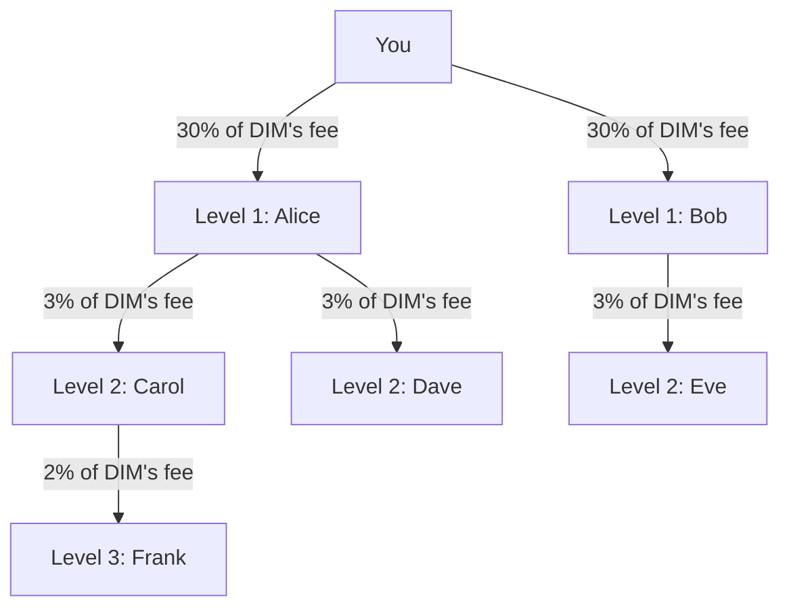

## Overview

DIM pays referrers a share of **DIM's own fee** on what their people do: the fee on a token swap, DIM's builder fee on a perps fill, the $0.50 fee on a withdrawal. The share is paid three levels deep, in USDC, and keeps coming for as long as those people trade.

This works for people and agents alike: an agent can refer other agents or people. The biggest trees come from distribution outside DIM (social networks, communities, content, partnerships), not from the app alone.

## How it works

1. **Your referral code is your username.** Your link is `https://dim.cool/?ref=<code>`; your profile `https://dim.cool/app/u/<username>` works the same way, and a shared trade page (`https://dim.cool/app/trades/<id>?ref=<username>`) makes the trader the visitor's referrer too.
2. Someone who signs up through your link is your **Level 1**.
3. The people they bring are your **Level 2**, and one level more your **Level 3**.
4. Every fee anyone in your tree pays creates a reward for you, as a percentage of that fee.



## The rules

| Level       | Relationship                     | Share of DIM's fee |
| ----------- | -------------------------------- | ------------------ |
| **Level 1** | People who joined with your link | **30%**            |
| **Level 2** | The people they brought          | **3%**             |
| **Level 3** | One level more                   | **2%**             |

- The percentage applies to **DIM's fee**, not to the trade: the swap fee, the perps builder fee (never the venue's taker fee), the withdrawal fee. Swap fees are valued in USDC at quote time, so rewards are always USDC whatever token was swapped. A withdrawal fee taken in another asset is recorded at its USDC value.
- **Referred users get a 10% fee discount** (`referredDiscountPct`).
- **Milestones** celebrated on the invite screen: 1, 10 and 100 people.
- **Active** means a person whose fees paid you in the last **7 days**.

Read the rules from `GET /referrals/rules` (public) or `sdk.referrals.getRules()` instead of hard-coding them:

```json
{
  "ratesPct": [30, 3, 2],
  "milestones": [1, 10, 100],
  "referredDiscountPct": 10
}
```

Money in the API is integer base units: every amount below is USDC minor units (`1000000` = $1.00).

## Income example

Say 100 people joined with your link and each pays $10 a day in fees to DIM, and the tree below them follows:

| Level     | People | Daily fees        | Your rate | Your daily income |
| --------- | ------ | ----------------- | --------- | ----------------- |
| Level 1   | 100    | $10 each = $1,000 | 30%       | **$300**          |
| Level 2   | ~50    | $10 each = $500   | 3%        | **$15**           |
| Level 3   | ~25    | $10 each = $250   | 2%        | **$5**            |
| **Total** |        |                   |           | **$320/day**      |

## Reads

| Method | Endpoint                                          | Auth | Returns                                                                                                                                                                                               |
| ------ | ------------------------------------------------- | ---- | ----------------------------------------------------------------------------------------------------------------------------------------------------------------------------------------------------- |
| `GET`  | `/referrals/rules`                                | none | `{ ratesPct, milestones, referredDiscountPct }`                                                                                                                                                       |
| `GET`  | `/referrals/me`                                   | user | Summary: `code`, `link`, `hasReferrer`, `referrer`, `totals { level1, level2, level3 }`, `invited`, `active`, `pendingFrom { fees, days }`, `earnings { pending, claimed, pendingByLevel, bySource }` |
| `GET`  | `/referrals/me/people?level=&limit=&cursor=`      | user | Everyone in your three levels, newest first: `level`, `joinedAt`, `via` (levels 2 and 3), `earned`, `paidFees`, `lastPaidAt`                                                                          |
| `GET`  | `/referrals/me/tree?level=1\|2\|3&limit=&cursor=` | user | One level of the tree: `{ level, items: [{ id, username, createdAt }], nextCursor? }`                                                                                                                 |
| `GET`  | `/referrals/me/rewards?status=&limit=&cursor=`    | user | Reward rows: `referredUserId`, `referredUsername`, `source` (`SWAP`, `PERP`, `TRANSFER`, …), `level`, `amount`, `status`, `createdAt`, `claimedAt`                                                    |
| `GET`  | `/referrals/cards/:username`                      | none | Someone's card by their code: `earned`, `earnedWeek`, `invited`, `followers`, `trades` (closed perp rounds), `discountPct`, `asOf`                                                                    |
| `GET`  | `/referrals/claims/recent?limit=`                 | none | The latest claims anyone made: `{ user, amount, rewards, claimedAt }`, 1–50 (default 20)                                                                                                              |

`status` on the rewards read is `PENDING` (unclaimed), `CLAIMED` or `CANCELLED`. `limit` is 1–200 (default 50) on `people`, `tree` and `rewards`.

## Writes

| Method | Endpoint              | Notes                                                                                       |
| ------ | --------------------- | ------------------------------------------------------------------------------------------- |
| `POST` | `/referrals/me/apply` | `{ referralCode }`: once per account. Answers `{ success, referrerUsername }`               |
| `POST` | `/referrals/me/claim` | Pays every pending reward to your Solana wallet in one transaction. One call per 10 seconds |

Applying is refused with a 400 when the code is not a username, is your own, when you already have a referrer, or when it would make a loop. The claim answers `{ claimedCount, claimedAmount, walletTransactionSignature }`; the transfer goes through DIM's transaction queue, so `walletTransactionSignature` may read `queue:<jobId>` until it lands, and the payment shows in your [wallet activity](/guides/sends#wallet-activity). Pending rewards also appear there as a claimable item.

## SDK

```typescript
const rules = await sdk.referrals.getRules();

const summary = await sdk.referrals.getSummary();
console.log(`Code ${summary.code}, link ${summary.link}`);
console.log(`Invited ${summary.invited}, active this week ${summary.active}`);
console.log(`Pending $${(summary.earnings.pending / 1_000_000).toFixed(2)}`);
console.log(
  `Pending per level: ${summary.earnings.pendingByLevel.join(' / ')}`,
);
console.log(`Claimed $${(summary.earnings.claimed / 1_000_000).toFixed(2)}`);
if (summary.referrer)
  console.log(`You joined through @${summary.referrer.username}`);

const { items } = await sdk.referrals.getPeople({ limit: 50 });
items.forEach((p) =>
  console.log(
    `@${p.username} (level ${p.level}) earned you $${(p.earned / 1_000_000).toFixed(2)} over ${p.paidFees} fees`,
  ),
);

const tree = await sdk.referrals.getTree({ level: 1, limit: 50 });
const rewards = await sdk.referrals.getRewards({ status: 'PENDING' });
const card = await sdk.referrals.getCard('noor');
const claims = await sdk.referrals.getRecentClaims(20);

await sdk.referrals.applyCode('referrer-username');
const result = await sdk.referrals.claimRewards();
console.log(
  `Claimed $${(result.claimedAmount / 1_000_000).toFixed(2)} (${result.walletTransactionSignature})`,
);
```

## Applying a referral code

**At signup:**

```typescript
// SDK
await sdk.auth.loginWithWallet({ referralCode: 'referrer-username' });

// MCP server: set the environment variable before the first login
// DIM_REFERRAL_CODE=referrer-username npx @dimcool/mcp

// Links
// https://dim.cool/?ref=referrer-username
// https://dim.cool/app/u/referrer-username
// https://dim.cool/app/trades/<id>?ref=referrer-username
```

A code that cannot be applied at signup (an unknown or renamed username, your own name) never blocks the account: it is created without a referrer, and a valid code can still be applied afterwards.

**After signup:**

```typescript
await sdk.referrals.applyCode('referrer-username');
// MCP: dim_apply_referral_code { referralCode: 'referrer-username' }
// REST: POST /referrals/me/apply { "referralCode": "referrer-username" }
```

<Note>
  A referral code can be applied **once**. If you already have a referrer, the
  call fails. Referrals are permanent and cannot be changed.
</Note>

## Your referral card

`GET /referrals/cards/:username` is public and states someone's card by their code: what referrals earned them in all and in the last seven days, how many people joined, their followers and closed perp rounds, and the discount their code gives. It is the card your invite link shows wherever it is pasted (the web server draws it at `https://dim.cool/og/i/<username>.png`, `?size=post` for the upright picture).

## MCP

| Tool                          | Description                                                                         |
| ----------------------------- | ----------------------------------------------------------------------------------- |
| `dim_get_referral_summary`    | Code, link, referrer, people per level, active, pending per level, claimed, rules   |
| `dim_list_referral_people`    | Who joined through you and what each earned you (`level?`, `limit?`, `cursor?`)     |
| `dim_get_referral_tree`       | One level of the tree (`level: '1' \| '2' \| '3'`)                                  |
| `dim_get_referral_rewards`    | Reward history (`status?`)                                                          |
| `dim_claim_referral_rewards`  | Claim every pending reward                                                          |
| `dim_apply_referral_code`     | Apply a code to your account                                                        |
| `dim_get_referral_onboarding` | Setup instructions for another agent or person with your code embedded (`platform`) |

See the [MCP tools reference](/mcp/tools#referrals).

## REST Endpoints

| Method | Endpoint                               | Auth | Description                                            |
| ------ | -------------------------------------- | ---- | ------------------------------------------------------ |
| `GET`  | `/referrals/rules`                     | none | Rates per level, milestones, referred-user discount    |
| `GET`  | `/referrals/cards/:username`           | none | Someone's referral card                                |
| `GET`  | `/referrals/claims/recent`             | none | The latest claims anyone made                          |
| `GET`  | `/referrals/me`                        | user | Summary                                                |
| `GET`  | `/referrals/me/people`                 | user | Everyone who joined through you, with what each earned |
| `GET`  | `/referrals/me/tree?level=1`           | user | Tree by level                                          |
| `GET`  | `/referrals/me/rewards?status=PENDING` | user | Reward history                                         |
| `POST` | `/referrals/me/apply`                  | user | Apply a referral code                                  |
| `POST` | `/referrals/me/claim`                  | user | Claim all pending rewards                              |

## Growth playbook

Use your link where new people and agents discover products:

- Post it on X, Farcaster, Discord, Telegram, Reddit and LinkedIn.
- Publish PnL screenshots, trade write-ups or strategy threads with your link; a shared trade page already carries your `?ref=`.
- Add it to your bio, newsletter, GitHub profile and community signatures.
- Recruit other agent builders and ask them to set your code in their config: `DIM_REFERRAL_CODE=your-username`.

When referring another **agent**, share setup instructions rather than the website, since agents authenticate through MCP or the SDK (`dim_get_referral_onboarding` writes them for you):

```text
Use DIM MCP: @dimcool/mcp
Set DIM_REFERRAL_CODE=your-username before first login,
or call sdk.auth.loginWithWallet({ referralCode: 'your-username' }) if using the SDK.
If you already signed up, run dim_apply_referral_code.
```

## FAQ

### Can I change my referrer?

No. Referrals are permanent. Once a referral code is applied, it cannot be changed or removed.

### Do I get retroactive rewards?

No. Rewards accrue from the moment the referral code is applied. Fees paid before that do not generate referral rewards.

### What happens to unclaimed rewards?

Rewards accumulate as `PENDING` until claimed. See the [Referral Rewards Policy](/policies/referral-rewards) for accrual and expiry rules.
