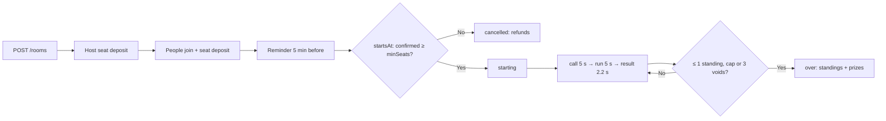

## What a room is

A room is "Last one standing" on a live market: a host opens it with a name, an entry, a number of seats, a prize split, an access mode and a start time. People take a seat by paying the entry into escrow. At the start time, if enough seats are confirmed, the game begins and every seat plays the same rounds as a [duel](/guides/duels):

1. **Call (5 s).** Every seat still standing calls `up` or `down`; calls are sealed.
2. **Lock.** The lock price is read from the price feeds.
3. **Run (5 s).** The close price is read at the end.
4. **Settle.** Wrong callers fall. Seats that made no call fall (`noCall: 'out'`). The result stays on screen 2.2 s, then the next round starts.

The room ends when one seat (or none) is left standing, when the round cap is reached, or after three void rounds in a row. The last ones standing take place 1; everyone else is placed by the round they fell in, latest first, and level players share a place (1, 2, 2, 4, …). Prizes follow the split, and players level on a place share the prizes of the places they take up.

Settlement reads the same deterministic price series as the duels and the charts (see [Prices](/guides/prices#realtime-ticks)).

## Rules

Served by `GET /rooms/rules`; the defaults today:

| Rule                  | Default                                                                                                             | Field                                          |
| --------------------- | ------------------------------------------------------------------------------------------------------------------- | ---------------------------------------------- |
| Entry                 | $1 to $10,000; presets $1, $10, $25, $100, $500                                                                     | `entryMin`, `entryMax`, `entryPresets`         |
| Seats                 | 10 to 1000; presets 20, 50, 100, 500                                                                                | `seatsMin`, `seatsMax`, `seatPresets`          |
| Min fill              | 20 % of the seats confirmed at the start time (at least 2), else the room is cancelled and refunded                 | `minFillBps`                                   |
| Fee                   | 5 % of the entries                                                                                                  | `feeBps`                                       |
| Host cut              | 1 % of the entries, carved **out of** DIM's 5 % (DIM keeps 4 % net)                                                 | `hostCutBps`                                   |
| Round cap             | 10 rounds under 100 seats, 15 from 100 seats up                                                                     | `roundCap`                                     |
| Splits                | `ALL`: the winner takes all; `TOP3`: 60 / 25 / 15 %; `TOP10`: the top 10 % of the seats on linearly falling weights | `top3Bps`, `top10PaidBps`                      |
| Everyone wrong        | the round is void: nobody falls for their call, the round still counts toward the cap                               | `allWrong: 'void'`                             |
| Flat close            | void, same as above                                                                                                 | `flatClose: 'void'`                            |
| No call               | out, even in a void round                                                                                           | `noCall: 'out'`                                |
| Ties                  | level players share the prizes of the places they take up                                                           | `ties: 'share'`                                |
| Seats per person      | one                                                                                                                 | `seatsPerPerson`                               |
| Start window          | between 15 minutes and 30 days from now                                                                             | `startWindowMinutes`                           |
| Call / round / result | 5 s / 10 s / 2.2 s                                                                                                  | `callSeconds`, `roundSeconds`, `resultSeconds` |
| Reconnect             | 45 s to come back after a drop; every round missed meanwhile is a miss (out)                                        | `reconnectSeconds`                             |

A round is also void when there is no usable price at the lock or the close, or when the market is not live when the round should start; three void rounds in a row end the room with the standings as they are.

## Money

- Entries = `entry × players` (confirmed seats at the start). The gross fee is 5 % of the entries; the host's 1 % comes out of it, so `feeNet` = 4 % with a host (5 % with no host) and feeds the referral rewards per seat.
- The pot = entries − gross fee. The prize table follows the split; each prize is rounded **down to the cent** and what is left is `rounding`, kept apart from fees.
- Fewer players than paid places renormalises the weights over the players there are, so the whole pot is paid.
- Example: 3 players at $1, `TOP3`, with a host: entries $3.00, gross fee $0.15, host cut $0.03, `feeNet` $0.12, pot $2.85; prizes $1.71 / $0.71 / $0.42, rounding $0.01.
- A cancelled room (unfilled, host, market) refunds every confirmed seat through the transaction queue; leaving before the start refunds your seat.

`outcome` on the state carries `{ end: 'played' | 'cancelled', reason: 'unfilled' | 'host' | 'market' | null, aliveAtEnd, round, hostCut, rounding, feeNet }`.

## Flow



1. **Create.** `POST /rooms { name, access, password?, marketId, entry, seats, split, startsAt }` (entry in USDC minor units, `startsAt` in epoch ms inside the start window). The host takes the first seat; the answer is `{ room, deposit }` with the unsigned seat deposit. Every room has a 6-character `code`; `/rooms/:idOrCode` accepts either.
2. **Seat deposits.** `GET /rooms/:id/seat/deposit/prepare`, `POST /rooms/:id/seat/deposit { signedTransaction }` or `POST /rooms/:id/seat/deposit/confirm-signature { signature }`. A seat is `PENDING` until its deposit confirms, then `CONFIRMED`; a pending seat left unfunded is released before the start.
3. **Join.** `POST /rooms/:id/join { password? }` → `{ seat, deposit, room }`. `PUBLIC` rooms are listed; `LINK` rooms are reachable by id or code; `PASSWORD` rooms need the password (403 `ROOM_PASSWORD`). One seat per person; `ROOM_FULL` when every seat is taken; `ROOM_STARTED` once `startsAt` has passed.
4. **Leave.** `POST /rooms/:id/leave` before the start refunds a confirmed seat. The host leaving cancels the room.
5. **Host edits.** `PATCH /rooms/:id { name?, access?, password?, seats?, split?, startsAt? }` only while nobody else is seated (409 `ROOM_TAKEN` after); `DELETE /rooms/:id` cancels with refunds (reason `host`).
6. **Reminders.** `PUT /rooms/:id/reminder { on }` on your seat; 5 minutes before the start the API sends `room:reminder` and a `room_reminder` notification to the seats that asked.
7. **Invites.** `POST /rooms/:id/invite { userIds }` (up to 50, you need a seat) sends a `game_invite` notification with the room's code.
8. **Start.** At `startsAt` the API checks the fill (`joined ≥ minSeats`, else cancelled `unfilled`), waits for the market to be live (a few retries, else cancelled `market`), releases pending seats, creates the game and emits `room:starting`. The room is `live` with a `gameId`.
9. **Rounds.** `POST /rooms/:id/call { round?, call }` during `call`; pass `round` so a late call is rejected. `POST /rooms/:id/forfeit` takes you out at the current round (no money moves). Only seats that are standing may call (`ROOM_OUT` otherwise).
10. **Over.** `GET /rooms/:id/state` carries `standings` (person, place, out round, prize) and `outcome`; prizes and the host cut go through the transaction queue.

### Chat and watching

- Room chat is the chat API with `context: { type: 'room', id: roomId }` (see [Chat](/guides/chat)). Seat holders can always talk; everyone else only while `chatMode` is `everyone`. The host switches it with `PUT /rooms/:id/chat-mode { mode: 'everyone' | 'players' }` (`room:chat:mode`).
- Anyone may watch: send `join-room` with the room id over the socket to join `room:<roomId>`; `room:watching { roomId, count }` keeps the watcher count. `join-rooms-lobby` joins `rooms:lobby`, where the public list refreshes from `room:updated`.

### The state

`GET /rooms/:idOrCode` is the room as listed (`RoomDto`: host, market, entry, seats, `joined`, split, access, `startsAt`, `status: 'open' | 'live' | 'over' | 'cancelled'`, `chatMode`, `gameId`, `minSeats`, `maxRounds`, `pot`, `prizes`, `faces`, `mine`, `hosted`, `reminder`, your `seat`, and `password` for the host only). `GET /rooms/:idOrCode/state` is the room in play:

```typescript
interface PriceRoomStateDto {
  room: RoomDto;
  gameType: 'price-room';
  seq: number; // monotonic
  serverNow: number; // ms; derive countdowns from phaseEndsAt − serverNow
  phase: 'lobby' | 'starting' | 'call' | 'run' | 'result' | 'over';
  phaseStartedAt: number | null;
  phaseEndsAt: number | null;
  gameId: string | null;
  round: number;
  maxRounds: number;
  entry: { price; priceRaw; ts } | null; // the lock price
  field: Array<{ seatId; person; out: number | null; call?; connected }>; // calls revealed from `run`
  alive: number;
  called: number; // how many called this round, never who called what
  calls: { up: number; down: number } | null; // the tally once locked
  last: RoomRoundDto | null; // the round just settled, during `result`
  rounds: RoomRoundDto[]; // { round, went, fell, voided, voidReason, entryPriceRaw, closePriceRaw }
  yourSeatId: string | null; // viewer-dependent
  yourCall: 'up' | 'down' | null; // viewer-dependent
  pot: number;
  prizes: number[];
  minSeats: number;
  watching: number;
  fallen: Array<{ person; round; place }>;
  standings: Array<{ person; place; out; prize }> | null; // once over
  outcome: { end; reason; aliveAtEnd; round; hostCut; rounding; feeNet } | null;
}
```

Reconnection follows the duel rules: 45 s to come back, the clock never pauses, `room:updated` is the full state and applies when its `seq` is equal or higher.

## REST

| Method | Path                                        | Auth     | Purpose                                                              |
| ------ | ------------------------------------------- | -------- | -------------------------------------------------------------------- |
| GET    | `/rooms/rules`                              | None     | The rules above                                                      |
| GET    | `/rooms/markets`                            | None     | Game-enabled markets with `status` and `live`                        |
| GET    | `/rooms`                                    | Optional | Public rooms that are open or live, plus the ones you host or sit in |
| POST   | `/rooms`                                    | Required | Create → `{ room, deposit }` (10/min)                                |
| GET    | `/rooms/:idOrCode`                          | Optional | The room (`RoomDto`)                                                 |
| GET    | `/rooms/:idOrCode/state`                    | Optional | The room in play (`PriceRoomStateDto`)                               |
| GET    | `/rooms/:idOrCode/members`                  | None     | The seated people                                                    |
| PATCH  | `/rooms/:id`                                | Host     | Edit while nobody else is seated                                     |
| DELETE | `/rooms/:id`                                | Host     | Cancel with refunds (204)                                            |
| POST   | `/rooms/:id/join`                           | Required | `{ password? }` → `{ seat, deposit, room }`                          |
| GET    | `/rooms/:id/seat/deposit/prepare`           | Required | The unsigned seat deposit                                            |
| POST   | `/rooms/:id/seat/deposit`                   | Required | `{ signedTransaction }` (5/min)                                      |
| POST   | `/rooms/:id/seat/deposit/confirm-signature` | Required | `{ signature }`                                                      |
| POST   | `/rooms/:id/leave`                          | Required | Leave before the start; refund (204)                                 |
| POST   | `/rooms/:id/forfeit`                        | Required | Out at the current round (204)                                       |
| POST   | `/rooms/:id/call`                           | Required | `{ round?, call: 'up' \| 'down' }`                                   |
| POST   | `/rooms/:id/invite`                         | Required | `{ userIds }` → `{ invited }`                                        |
| PUT    | `/rooms/:id/reminder`                       | Required | `{ on }` (204)                                                       |
| PUT    | `/rooms/:id/chat-mode`                      | Host     | `{ mode: 'everyone' \| 'players' }` (204)                            |

## Socket events

| Event                      | Room                               | Payload                                                                               |
| -------------------------- | ---------------------------------- | ------------------------------------------------------------------------------------- |
| `room:updated`             | `room:<id>`, `rooms:lobby`, game   | `{ room, seq }` in the lobby; the full `PriceRoomStateDto` in play                    |
| `room:seat:joined`         | `room:<id>` + the joiner's `user:` | `{ roomId, userId, joined, pot, prizes, seq }`                                        |
| `room:seat:left`           | `room:<id>`                        | `{ roomId, userId, joined, pot, prizes, seq }`                                        |
| `room:cancelled`           | `room:<id>` + each seat's `user:`  | `{ roomId, reason: 'unfilled' \| 'host' \| 'market', seq }`                           |
| `room:reminder`            | each opted-in seat's `user:`       | `{ roomId, startsAt, seq }`                                                           |
| `room:starting`            | `room:<id>` + each seat's `user:`  | `{ roomId, gameId, field, minSeats, pot, prizes, maxRounds, seq }`                    |
| `room:round:started`       | `room:<id>`                        | `{ roomId, gameId, seq, round, callEndsAt, runEndsAt, serverNow, alive }`             |
| `room:player:called`       | `room:<id>`                        | `{ roomId, gameId, seq, round, userId }` (never the call)                             |
| `room:round:locked`        | `room:<id>`                        | `{ roomId, gameId, seq, round, entry, calls: { up, down }, fieldCalls, runEndsAt }`   |
| `room:round:settled`       | `room:<id>`                        | `{ roomId, gameId, seq, round, went, voided, voidReason, entry, close, fell, alive }` |
| `room:player:disconnected` | `room:<id>`                        | `{ roomId, gameId, seq, userId, reconnectDeadline }`                                  |
| `room:player:connected`    | `room:<id>`                        | `{ roomId, gameId, seq, userId }`                                                     |
| `room:completed`           | `room:<id>`                        | `{ roomId, gameId, seq, standings, hostCut, rounding, end }`                          |
| `room:watching`            | `room:<id>`                        | `{ roomId, count }`                                                                   |
| `room:chat:mode`           | `room:<id>`                        | `{ roomId, mode }`                                                                    |

## Errors

| Code                                                                     | Status  | Meaning                                                                                |
| ------------------------------------------------------------------------ | ------- | -------------------------------------------------------------------------------------- |
| `ROOM_NOT_FOUND`                                                         | 404     | No room with that id or code                                                           |
| `ROOM_INVALID`                                                           | 400     | Entry, seats, password or `startsAt` outside the rules                                 |
| `ROOM_PASSWORD`                                                          | 403     | Wrong or missing password                                                              |
| `ROOM_FULL`                                                              | 409     | Every seat is taken                                                                    |
| `ROOM_STARTED`                                                           | 400     | `startsAt` has passed; no more joins                                                   |
| `ROOM_TAKEN`                                                             | 409     | Someone else is seated; the host can no longer edit                                    |
| `ROOM_CLOSED`                                                            | 400     | The room is not open (or the game is over)                                             |
| `ROOM_NOT_HOST`                                                          | 403     | Host-only route                                                                        |
| `ROOM_ALREADY_SEATED`                                                    | 409     | You already have a seat                                                                |
| `ROOM_NOT_SEATED`                                                        | 403/404 | You need a seat for that                                                               |
| `ROOM_NOT_PLAYER`                                                        | 403     | You are not in this game                                                               |
| `ROOM_OUT`                                                               | 400     | You already fell                                                                       |
| `ROOM_SEAT_FUNDED`                                                       | 400     | The seat is already funded                                                             |
| `CALL_LOCKED`                                                            | 400     | Not in `call`, the round locked, you already called, or `round` is not the current one |
| `MARKET_NOT_GAME_ENABLED`, `MARKET_NOT_GAME_ELIGIBLE`, `MARKET_NOT_LIVE` | 422     | As for [duels](/guides/duels#errors)                                                   |

## SDK

```typescript
const rules = await sdk.rooms.getRules(); // RoomRules, memoised
const { room, deposit } = await sdk.rooms.create({
  name: 'Friday BTC',
  access: 'PUBLIC',
  marketId: 'spot:BTC-USD',
  entryMinor: 10_000_000,
  seats: 20,
  split: 'TOP3',
  startsAt: Date.now() + 30 * 60_000,
});
// deposit.transaction is the host's unsigned seat deposit; the wallet signer funds it:
await sdk.stakeAndJoinRoom(room.id); // join (or reuse your pending seat), sign, poll until CONFIRMED

// Someone else, from a share link
const byCode = await sdk.rooms.get('ABC123'); // id or code
const seated = await sdk.stakeAndJoinRoom(byCode.id, 'optional-password');

// Play
const state = await sdk.rooms.getState(room.id); // RoomSnapshot
const view = toRoomView(state, myUserId); // yourSeat, isAlive, yourPlace, yourPrize…
if (view.phase === 'call' && view.isAlive && view.yourCall === null) {
  await sdk.rooms.call(room.id, state.round, 'up');
}
await sdk.rooms.forfeit(room.id); // out at the current round
await sdk.rooms.leave(room.id); // before the start: refunded
await sdk.rooms.cancel(room.id); // host only
await sdk.rooms.update(room.id, { seats: 50 }); // host, while nobody else is seated
await sdk.rooms.invite(room.id, ['user-id']);
await sdk.rooms.setReminder(room.id, true);
await sdk.rooms.setChatMode(room.id, 'players');
await sdk.rooms.members(room.id);
await sdk.rooms.list(); // public open/live rooms plus yours
await sdk.rooms.getMarkets();
```

The seat deposit routes are `prepareSeatDeposit`, `submitSeatDeposit(id, signedTx)` and `confirmSeatSignature(id, signature)`. `sdk.rooms` keeps the snapshot in a socket-fed store (`observeRoom`, `observeRoomSnapshot`, `createRoomSessionController`, `createRoomListSessionController`) that joins `room:<roomId>` and `rooms:lobby` and applies the `seq` rules above; errors are `RoomError` with `reason` `not-found | password | full | taken | seated | not-seated | started | closed | not-host | invalid | locked | market-closed | insufficient | failed`. Money helpers (`roomPot`, `roomFeeGross`, `roomHostCut`, `roomMinSeats`, `roomMaxRounds`, `roomPrizeTable`, `roomSharedPrize`) are ports of the API's.

## React

```tsx
import {
  RoomRuntimeSessionProvider,
  useRoom,
  useRoomByCode,
  useRoomCommands,
  useRoomFunding,
} from '@dimcool/react-sdk';

function RoomPage({ code }: { code: string }) {
  const { roomId, notFound } = useRoomByCode(code); // /r/<code> → id
  if (notFound) return <p>No such room</p>;
  return roomId ? (
    <RoomRuntimeSessionProvider roomId={roomId}>
      <Arena roomId={roomId} />
    </RoomRuntimeSessionProvider>
  ) : null;
}

function Arena({ roomId }: { roomId: string }) {
  const room = useRoom({ roomId }); // screen, phase, secondsLeft, entry, field, alive, yourCall, standings, outcome, prices
  const commands = useRoomCommands({ roomId }); // join, leave, cancel, update, call, forfeit, remind, invite, setChatMode
  const funding = useRoomFunding({ roomId }); // join + seat deposit with the wallet signer, polled until CONFIRMED
  if (room.screen === 'lobby' && !room.isPlayer)
    return <button onClick={() => funding.start()}>Take a seat</button>;
  if (room.phase === 'call' && room.isAlive && !room.yourCall)
    return (
      <>
        <button onClick={() => commands.call(room.round, 'up')}>Up</button>
        <button onClick={() => commands.call(room.round, 'down')}>Down</button>
      </>
    );
  return <span>{room.secondsLeft}s</span>;
}
```

Reads: `useRooms({ refreshMs? })` (on `rooms:lobby`, polled and refetched on every room event), `useRoomRules()`, `useRoomByCode(code)`.

## MCP

| Tool                                | Purpose                                                                                                                       |
| ----------------------------------- | ----------------------------------------------------------------------------------------------------------------------------- |
| `dim_list_rooms`                    | Public open and live rooms plus yours, with the money formatted and a share url                                               |
| `dim_get_room`                      | `{ roomIdOrCode }`: a compact view with phase, `secondsLeft`, who is standing, your call, standings                           |
| `dim_get_room_rules`                | The rules with the money formatted                                                                                            |
| `dim_create_room`                   | `{ name, marketId, entry, seats, split, access?, password?, startsAtMinutes? }`: host and fund your seat                      |
| `dim_join_room`                     | `{ roomIdOrCode, password? }`: take and fund a seat (external wallet: sign, then `dim_confirm_room_seat`)                     |
| `dim_confirm_room_seat`             | `{ roomId, signature }` after broadcasting the seat deposit yourself                                                          |
| `dim_room_loop`                     | `waiting` (with `startsAt`), `your-call` (round, ticks, `secondsLeft`), `over` (standings, your place and prize) or `timeout` |
| `dim_room_call`                     | `{ roomIdOrCode, round, call }`                                                                                               |
| `dim_leave_room`, `dim_cancel_room` | Give the seat back before the start; the host cancels with refunds                                                            |

The loop for an agent: `dim_join_room` (or `dim_create_room`) → `dim_room_loop` until `your-call` → `dim_room_call` → `dim_room_loop` → … until `over`. Entries count against `maxBetPerGame` and the daily spend limit. See the [MCP tools reference](/mcp/tools#rooms-last-one-standing).

<Note>
  The shared bits with duels (the round clock, the lock and close prices, the
  reconnect window, `seq` and `serverNow`) are described once in the [Duels
  guide](/guides/duels).
</Note>
